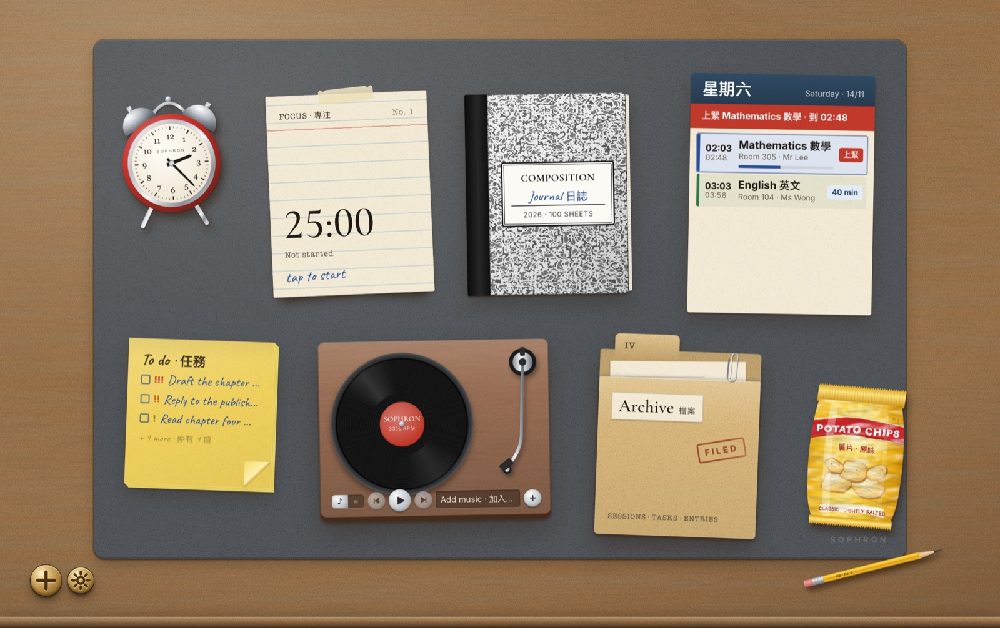
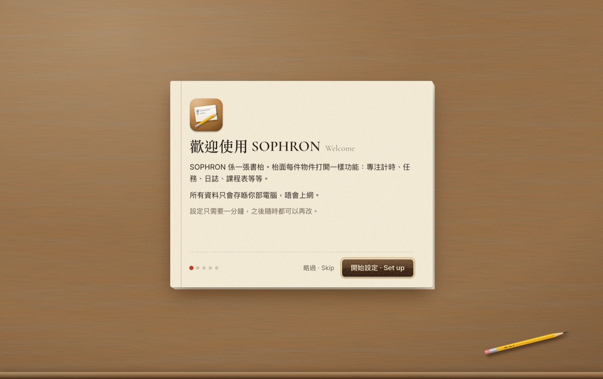
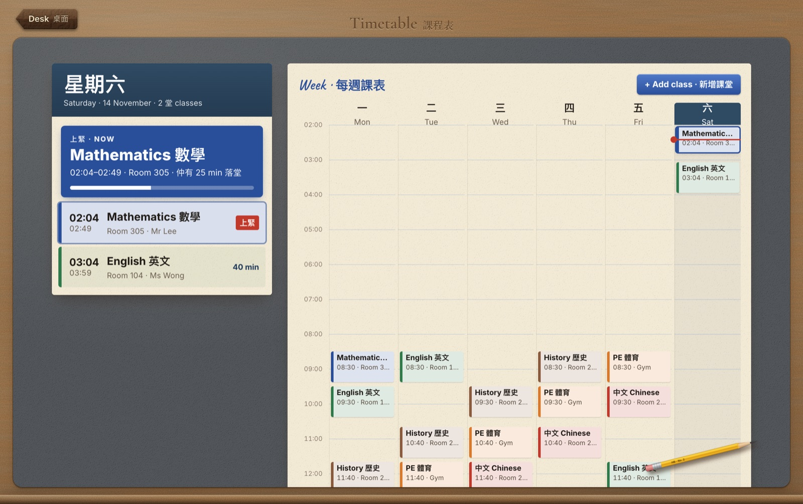
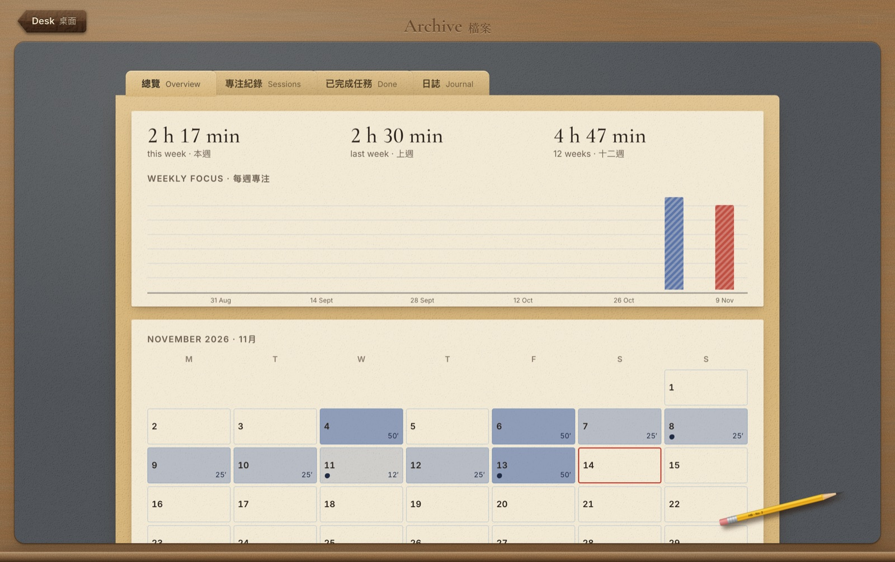
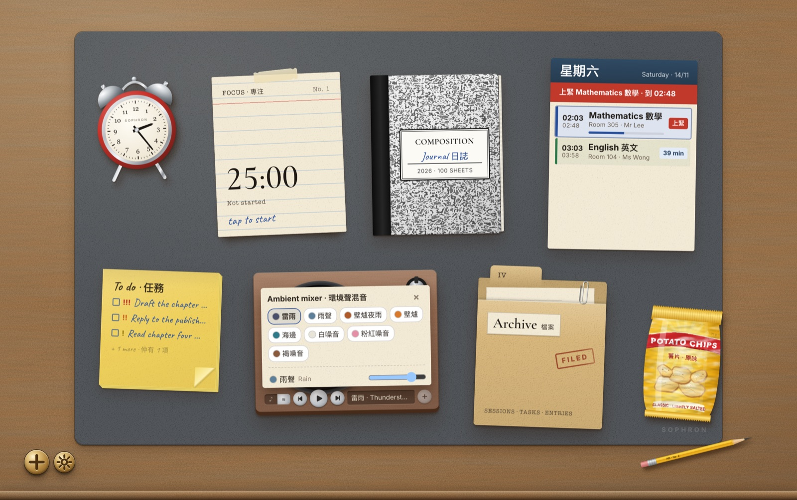
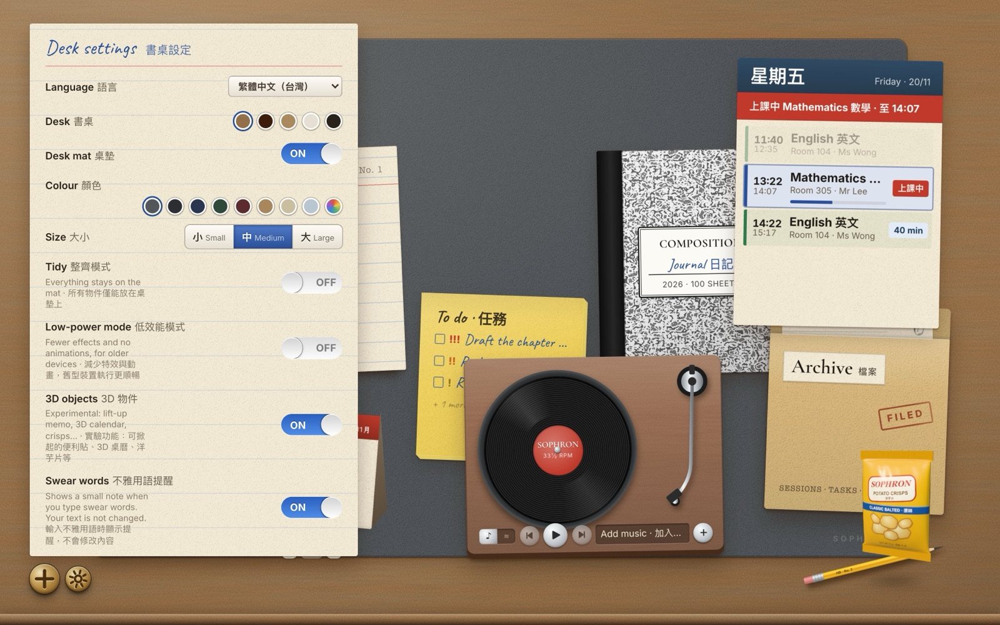
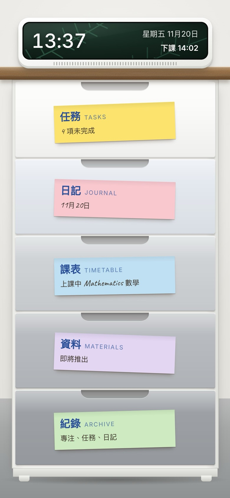
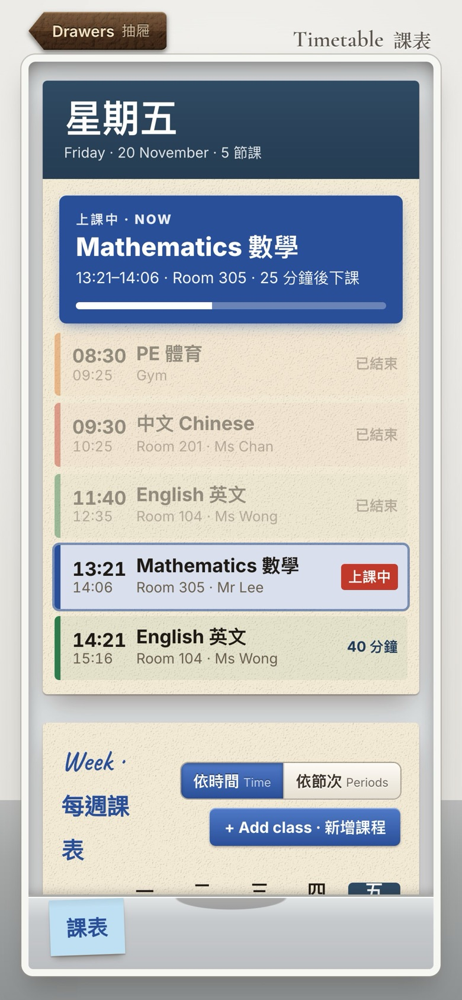

<p align="center">
  
</p>

<h1 align="center">SOPHRON</h1>

<p align="center">
  A private desk for your work: on your computer, your tablet and your phone
</p>

<p align="center">
  <a href="https://github.com/HelloWorld233a/SOPHRON/releases"></a>
  
  
  
  
  
  
</p>

<p align="center">
  <a href="README.zh-Hant.md">繁體中文</a> · <b>English</b>
</p>

<p align="center">
  
</p>

<p align="center">
  <a href="https://helloworld233a.github.io/SOPHRON/"><b>▶ Try it online</b></a> — a demo with sample tasks, timetable and journal, right in your browser (nothing is saved).
  <br>
  <a href="https://github.com/HelloWorld233a/SOPHRON/releases/latest"><b>⬇ Download</b></a> for macOS, Windows and Android.
</p>

---

## Contents

1. [What SOPHRON is](#1-what-sophron-is)
2. [Screenshots](#2-screenshots)
3. [Features](#3-features)
4. [SOPHRON on a phone](#4-sophron-on-a-phone)
5. [Languages](#5-languages)
6. [Your desk, your way](#6-your-desk-your-way)
7. [Installation](#7-installation)
8. [Your data](#8-your-data)
9. [Development status](#9-development-status)
10. [Architecture](#10-architecture)
11. [Roadmap](#11-roadmap)
12. [Feedback, licence and acknowledgements](#12-feedback-licence-and-acknowledgements)

## 1. What SOPHRON is

SOPHRON is a productivity app built as a private desk. The main screen is a desk, and every object on it opens one feature: an index card for the focus timer, a sticky note for tasks, a composition book for the journal, a folder for the archive, a timetable card for your classes and a record player for music. Move, resize, add and remove them until the desk suits the way you work.

On a phone, the same app becomes a **drawer unit** that stands beside your desk: one drawer for each feature, with a clock on top.

SOPHRON is **local-first**: everything stays on your own device. There is no account, no cloud and nothing is sent over the internet.

> This repository only distributes installers. The source code is not public at the moment.

**Try it without installing:** [the online demo](https://helloworld233a.github.io/SOPHRON/) runs in your browser, like a demo unit in a shop. It comes with sample tasks, a timetable, journal pages and focus history, and the 3D objects are on. It starts afresh every time and saves nothing. Open it on your phone to see the drawer unit.

## 2. Screenshots

The screenshots show demo data.

| The desk | First-run setup |
| :---: | :---: |
|  |  |
| **Tasks** | **Timetable** |
|  |  |
| **Archive** | **Record player and ambient mixer** |
|  |  |
| **Desk settings (with Language)** | **On a phone** |
|  |   |

## 3. Features

| Feature | What it does |
| --- | --- |
| **Focus timer** | Pomodoro-style focus, short break and long break; your own lengths and auto-start; link a session to a task; today's and the last seven days' statistics; a system notification when a phase ends. The timer keeps exact time even when you switch rooms or the computer sleeps. |
| **Tasks** | Add, tick off and reorder tasks; three priority levels; notes; filter by open, done or all; start a focus session straight from a task. |
| **Journal** | One page per day with bold, italic, headings, lists and quotes; saves as you type; jump to any date; word count. |
| **Archive** | A twelve-week focus chart, a month calendar of focus minutes and journal days, focus history, finished tasks and every journal page. |
| **Timetable** | Your week of classes with subject, time, room, teacher, colour and notes; shows the class in progress and the next one. Set up the periods of your school day (with recess and lunch) and view the week by time or by period; add a class to several days at once, or one subject into many periods in one go; warns about overlaps; when the bell times change, the classes move with them. |
| **Record player** | Plays your own music files: playlist, repeat, shuffle, volume and a progress bar you can drag. Or switch to ambient mode and mix rain, thunder, wind, waves, fireplace and white, pink and brown noise, with eight presets. |
| **Memo and more** | Sticky memos (one can lift up to hide a secret underneath, with an optional password), an alarm clock, a desk calendar and a bag of crisps. |
| **Data safety** | A local SQLite database; an automatic daily backup (the latest ten are kept); manual backup and JSON export; undo after deleting. |
| **Swear word reminder** | A small note when you type swear words in Cantonese, English or Mandarin. Your text is never changed, and you can turn it off. |
| **Never a blank window** | If one object can't be drawn, a small card takes its place and the rest of the desk keeps working. Damaged saved settings go back to their defaults. |

## 4. SOPHRON on a phone


The idea: **the computer is the desk, the phone is the drawers beside it.** On a phone (Android, portrait) SOPHRON doesn't squeeze the desk onto a small screen. It shows a white five-drawer unit instead:

- **The drawers:** Tasks, Journal, Timetable, Materials and Archive. A memo on each drawer says what is inside: how many tasks are open, today's date, the class now or next.
- **The wooden top** runs across the screen in your desk's own wood. Change the wood on the computer and the phone follows, so the two read as one piece of furniture.
- **The clock** on top shows the time, the date and the next class (or when this one ends), and the time left during a focus session. Tap it for Focus and Settings.
- **Open a drawer** and its room slides out, coloured like the inside of that drawer. "Drawers" at the top left takes you back.
- Every room has a phone layout of its own: Tasks, Journal, Archive and Timetable fit screens down to 320 px wide.
- Tablets keep the full desk in landscape. You can move objects by pressing and holding them (a ring fills under your finger), so a swipe never drags anything by accident.

**Phone ⇄ computer sync (experimental, off by default).** A phone can pair with the computer over the same Wi-Fi and keep tasks, the timetable, journal pages and focus history in step, with no account and no server. Pairing uses a 6-digit code that is never sent; every sync is encrypted. While it is being tested, it is switched off and hidden: turn it on in **Developer settings → Phone link** (tap the version number in desk settings seven times to unlock them). While it is off, nothing listens on the network.

<br clear="right">

## 5. Languages

**Desk settings → Language** offers three choices. The language is kept on each device.

| Choice | What you see |
| --- | --- |
| **繁體中文（台灣）** | English and Traditional Chinese side by side, in formal written Chinese as used in Taiwan (書桌、桌墊、課表、日記、洋芋片…). |
| **简体中文（新加坡）** | English and Simplified Chinese with Singapore wording (设置、文件夹、时间表、薯片…), and a few lines in a Singapore voice: finish setup and it says “搞定了！”. |
| **English** | English only. |

Dates, times and timer notifications follow the language. Only the interface changes: your tasks, journal and class names stay exactly as you wrote them.

## 6. Your desk, your way

- **Drag** an object to move it and drag its bottom-right corner to resize it (on a touch screen, press and hold first). Any object can be pinned on top.
- **Add and remove** objects from the “＋” drawer at the bottom left. Memos, alarm clocks and crisps can be placed more than once.
- **Colours per object:** the alarm clock case, the task note paper, the timetable card header and the record player plinth.
- **Desk settings (⚙):** five wood finishes; eight desk mat colours or your own; three mat sizes; a tidy mode that keeps everything on the mat; keep the window on top; full screen on Windows (`F11`).
- **3D objects (experimental, on by default on computers):** a hardbound journal, a focus cube, a tent-shaped calendar, a bag of crisps and the lift-up memo. Switching 3D on or off never touches your data.
- **Low-power mode:** fewer effects and no room animations, for older devices. It starts on by itself on Android older than 10 and on older or entry-level chips ([the list is public](docs/LOW_POWER_CHIPS.md)), and it holds 3D back.
- **First-run setup** helps you choose the desk, the objects and the focus length, and can be run again from desk settings.

Every object is a built-in **desk plugin**: nine of them, registered when the app is built. Their position, size, order and settings are saved in the local database. Third-party plugins are not supported yet.

## 7. Installation

Download the latest version from [Releases](https://github.com/HelloWorld233a/SOPHRON/releases):

| System | File |
| --- | --- |
| macOS (Apple Silicon) | `SOPHRON_…_macOS_AppleSilicon.dmg` |
| Windows 10 / 11 (64-bit) | `SOPHRON_…_Windows_x64-setup.exe` |
| Android phones and tablets (arm64, Android 7.0 or later) | `SOPHRON_…_Android_arm64.apk` |

**macOS**

1. Open the `.dmg` and drag SOPHRON into Applications.
2. SOPHRON isn't signed by an Apple developer yet, so macOS says it can't verify the developer. The first time, right-click SOPHRON in Applications and choose **Open**. On macOS 15 or later, open it once, then go to **System Settings → Privacy & Security** and click **Open Anyway**. After that it opens normally.
3. If macOS says SOPHRON **“is damaged”**, you have the beta 4 download from before 13:40 (UTC+8) on 20 November 2026: delete it and download it again.

**Windows**

1. Run the `setup.exe`.
2. If you see “Windows protected your PC”, click **More info**, then **Run anyway**.
3. The installer needs Microsoft WebView2 and downloads it if it is missing.

**Android**

1. Download the `.apk` on the phone or tablet (or copy it there).
2. Open it and allow installing apps from that source (the browser or file manager you used).
3. To update, install the newer `.apk` over the old one. Every release is signed with the same key, so your data stays.
4. **Uninstalling deletes your data**, backups included (they are kept inside the app). There is no export on Android yet.
5. Music files you add play until you close the app; they are not kept in the playlist. Ambient sounds are not affected.

**Basics**

- Click an object to open it; **Desk** at the top left (or `Esc`) takes you back. On a phone, tap a drawer; **Drawers** takes you back.
- `⌘` (`Ctrl` on Windows) + `1` to `6`: Desk, Focus, Tasks, Journal, Archive, Timetable.

**Checking a download.** Each release has a `SHA256SUMS.txt`:

```bash
# macOS
shasum -a 256 SOPHRON_*.dmg
```

```powershell
# Windows
certutil -hashfile SOPHRON_0.1.0-beta.4_Windows_x64-setup.exe SHA256
```

## 8. Your data

All of it stays on your device: no account, no analytics, nothing online.

| System | Location |
| --- | --- |
| macOS | `~/Library/Application Support/app.sophron.desktop/` |
| Windows | `%APPDATA%\app.sophron.desktop\` |
| Android | Inside the app's own storage (removed when you uninstall) |

The database is `sophron.db`; automatic backups are in the `backups` folder next to it. The database is also backed up before every upgrade changes it.

## 9. Development status

**Version: 0.1.0-beta.4 (beta)**

| Item | Status |
| --- | --- |
| macOS (Apple Silicon) | Installer available. |
| macOS (Intel) | Not available yet. |
| Windows 10 / 11 (64-bit) | Installer available. |
| Android tablets | APK available since beta 3 (landscape, the full desk). |
| Android phones | **New in beta 4:** the drawer unit (portrait). Built and checked on a computer; **please report how it runs on your phone.** |
| Phone ⇄ computer sync | Experimental, off by default (Developer settings → Phone link). |
| Code signing | Not signed by an Apple or Microsoft developer yet (see Installation). |

This is a beta and may still have bugs. Use **Back up** in desk settings now and then.

### What's new in 0.1.0-beta.4

- **Phones:** the drawer unit with its clock and wooden top, and phone layouts for every room.
- **Three languages:** Traditional Chinese (Taiwan), Simplified Chinese (Singapore) or English only.
- **Chinese text** rewritten in formal written Traditional Chinese as used in Taiwan.
- **Never a blank window:** one object that can't be drawn no longer takes the whole desk down.
- **Phone ⇄ computer sync:** built, encrypted and waiting in Developer settings while it is tested.
- **macOS:** the app is now fully signed (ad hoc), so a downloaded copy is no longer reported as damaged.
- Many fixes.

<details>
<summary>Earlier versions</summary>

**0.1.0-beta.3**

- Android tablets: an APK (landscape, full screen); press and hold an object to move it.
- 3D objects for everyone (experimental, on by default on computers).
- Low-power mode, on by itself on older devices.
- The online demo.
- Long memos scroll on a touch screen; many fixes.

**0.1.0-beta.2**

- Record player panel: playlist, repeat, shuffle, volume, progress and colour.
- Timetable: periods, a class on several days at once, batch adding, overlap warnings, classes that follow the bell times.
- Windows: full screen (`F11`) and a proper Chinese font (Microsoft JhengHei).
- Smoother room transitions; text can no longer be selected by accident.

</details>

## 10. Architecture

| Layer | Technology |
| --- | --- |
| App framework | [Tauri 2](https://tauri.app/): one app for macOS, Windows and Android, drawn by the system's own web engine |
| Interface | React 19, TypeScript, Vite |
| Back end | Rust (2024 edition) |
| Database | SQLite through rusqlite (WAL mode, versioned migrations) |
| Text editor | TipTap |
| Sound | Web Audio API (ambient sounds are synthesised live; no recordings) |
| Phone link | UDP discovery, SPAKE2 pairing, ChaCha20-Poly1305 encryption (experimental) |

- **The timer** runs in Rust on wall-clock timestamps, so it stays exact through room changes and sleep.
- **Migrations back up first**, so an upgrade can't lose data.
- **Skeuomorphic design:** everything imitates real objects; all textures and icons are original artwork.
- **One set of labels, three languages:** Simplified Chinese is generated from the Taiwan text, then Singapore words and phrases are swapped in.

## 11. Roadmap

Planned, with no dates yet:

- Phone ⇄ computer sync for everyone, with pairing by QR code.
- The Materials drawer: send photos and notes from the phone to a folder on the computer.
- Code signing for macOS and Windows.
- Finishing the 3D objects and dropping the “experimental” label.
- Export and import on Android; testing on more phones and tablets.
- Confirming the minimum system versions.

## 12. Feedback, licence and acknowledgements

**Feedback.** The source code isn't public, so code contributions can't be accepted yet. Bug reports and ideas are very welcome in [Issues](https://github.com/HelloWorld233a/SOPHRON/issues): please include your system and its version, the SOPHRON version and the steps that lead to the problem.

**Licence.** No licence has been chosen yet.

**Acknowledgements.** SOPHRON is built with [Tauri](https://tauri.app/), [React](https://react.dev/), [Vite](https://vite.dev/), [TipTap](https://tiptap.dev/), [rusqlite](https://github.com/rusqlite/rusqlite) and [SQLite](https://sqlite.org/). The fonts Inter, Caveat and Cormorant Garamond are under the SIL Open Font License, through [Fontsource](https://fontsource.org/).
