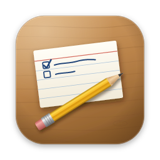
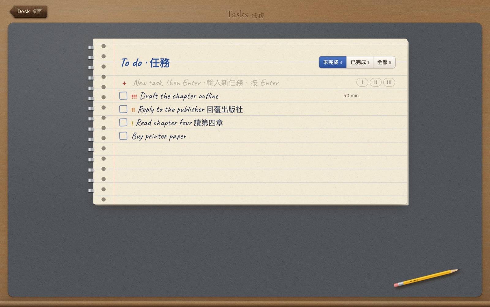

<p align="center">
  
</p>

<h1 align="center">SOPHRON</h1>

<p align="center">
  A private desk for your work
</p>

<p align="center">
  <a href="https://github.com/HelloWorld233a/SOPHRON/releases"></a>
  
  
  
  
  
</p>

<p align="center">
  <a href="README.zh-Hant.md">繁體中文</a> · <b>English</b>
</p>

<p align="center">
  
</p>

<p align="center">
  <a href="https://helloworld233a.github.io/SOPHRON/"><b>▶ Try it online</b></a> — a demo with sample tasks, timetable and journal, right in your browser (nothing is saved).
</p>

---

## 1. SOPHRON

**A private desk for your work.**

## 2. Overview

SOPHRON is a productivity app built around the idea of a private digital desk. The main screen is a desk, and each object on it opens one feature: an index card for the focus timer, a sticky note for tasks, a composition book for the journal, a folder for the archive and a timetable card for your weekly classes. You can arrange, resize, add and remove these objects to suit the way you work.

SOPHRON is a local-first desktop app. All data stays on your own computer: there is no account and nothing is sent over the network.

> This repository only distributes installers. The source code is not currently public.

**Try it without installing:** [the online demo](https://helloworld233a.github.io/SOPHRON/) runs in your browser, like a demo unit in a shop. It comes with example tasks, a timetable, journal entries and focus history, and the 3D objects are switched on. It starts afresh every time and saves nothing. The demo is a sampler: the real app keeps your data on your computer, backs it up, and plays your own music.

## 3. Screenshots

The screenshots below come from the current version and show demo data.

| The desk | First-run setup |
| :---: | :---: |
|  |  |
| **Tasks** | **Timetable** |
|  |  |
| **Archive** | **Record player and ambient mixer** |
|  |  |

## 4. Features

| Feature | Description |
| --- | --- |
| Focus timer | Pomodoro-style timer with focus, short break and long break; adjustable lengths and auto-start; can be linked to the task you are working on; statistics for today and the last seven days; a system notification when a phase ends. |
| Tasks | Add, complete and reorder tasks; three priority levels; notes; filter by open, done or all; start a focus session on a task directly. |
| Journal | One page per day with bold, italic, headings, bulleted and numbered lists and quotes; saves automatically; date navigation; word count. |
| Archive | Weekly focus chart (twelve weeks), a month calendar showing focus minutes and journal entries per day, focus history, completed tasks and a list of journal entries. |
| Timetable | Weekly timetable with subject, time, room, teacher, colour and notes; shows the class in progress and the next class today. Set up the periods of your school day and view the week by time or by period; add a class on several days at once, or place one subject into many periods in one go; a warning when classes overlap; changing the bell times moves the classes with them. |
| Record player | Plays music files you choose from your computer. Tap the record for its panel: playlist (play, reorder, remove), repeat all or one, shuffle, volume, a progress bar you can drag, and the record's colour. Or switch to ambient mode and layer rain, thunder, wind, waves, fireplace, white, pink and brown noise freely, with eight presets. |
| Data safety | Local SQLite database; automatic daily backup (the latest ten are kept); manual backup and JSON export; undo when deleting items. |
| Language reminder | Shows a small note when swear words are typed in Cantonese, English or Mandarin. The text is never changed, and the reminder can be turned off. |

## 5. Desk customisation and plugin system

### Customising the desk

- Drag an object to move it, and drag its bottom-right corner to resize it.
- Any object can be pinned so it stays above the others.
- Some objects have their own colour options: the alarm clock case, the task note paper, the timetable card header and the record player plinth.
- Desk settings: five wood finishes; eight desk mat colours plus a custom colour; three mat sizes; a tidy mode that keeps every object on the mat; keep the window on top.
- First-run setup: on first launch, SOPHRON helps you choose the desk style, the objects on the desk and the focus length. It can be run again from desk settings.

### Plugin system (current state)

Every object on the desk is a desk plugin. The plugin system currently works as follows:

| Item | Current state |
| --- | --- |
| Where plugins come from | Built into the app and registered automatically at build time. Loading third-party plugins at runtime is not supported yet. |
| Built-in plugins | Alarm clock, Focus, Tasks, Journal, Archive, Timetable, Record player, Memo and Crisps: nine in total. |
| What you can do with them | Add or remove them from the "+" drawer in the bottom-left corner; drag; resize (aspect ratio is kept); pin on top; change colours per object. Memos, alarm clocks and crisps can be placed more than once. |
| Storage | The position, size, stacking order and settings of every object are saved in the local database and restored on the next launch. |
| 3D plugins | **Experimental, and open to everyone.** A switch in desk settings (on by default on computers). They include a hardbound journal book, a focus cube, a tent-shaped desk calendar, a bag of crisps and a memo you can lift up (with a hidden place underneath, and an optional password). Switching 3D on or off never changes your data. 3D is held back while low-power mode is on. |

## 6. Architecture and technology

| Layer | Technology |
| --- | --- |
| Desktop framework | [Tauri 2](https://tauri.app/), a lightweight desktop framework that renders the interface with the system web engine |
| Interface | React 19, TypeScript, Vite |
| Backend | Rust (2024 edition) |
| Database | SQLite (through rusqlite, with WAL mode and versioned migrations) |
| Text editor | TipTap |
| Audio | Web Audio API (ambient sounds are synthesised in real time; no recordings are used) |

Key design points:

- **The timer** runs in Rust on wall-clock timestamps, so it stays accurate when you switch rooms or the computer sleeps.
- **The database is backed up automatically before each migration**, so an upgrade cannot lose data.
- **The interface** uses a skeuomorphic design (imitating the look of real objects); all textures and icons are original artwork.

## 7. Development status

**Version: 0.1.0-beta.4 (beta)**

| Item | Status |
| --- | --- |
| macOS (Apple Silicon) | Installer available; features tested on the developer's computer with the development build. |
| macOS (Intel) | Not available yet. |
| Windows 10 / 11 (64-bit) | Installer available. The Chinese font problem in beta 1 is fixed in beta 2 (please report it in Issues if you still see it). |
| Android phones and tablets (arm64, Android 7.0 or later) | An installable APK (tablets since beta 3; phones get their own drawer layout in beta 4). Built and checked on a computer; **please report how it runs on your device.** |
| Code signing | Not signed yet (the system shows a security prompt during installation; see below). |
| Minimum OS version | To be confirmed. |

This is a beta release and may still contain bugs. Please use the Back up button in desk settings regularly.

### What's new in 0.1.0-beta.4

- **Three languages:** Settings → Language: Traditional Chinese (Taiwan), Simplified Chinese (Singapore wording) or English only. Only the interface changes, never what you write.
- **Chinese text** now uses formal written Traditional Chinese as used in Taiwan.
- **Phones get a drawer unit:** on a phone the desk becomes a five-drawer unit with a wooden top and a clock; each drawer opens one room.
- **Nothing can blank the whole window any more:** an object that can't be drawn shows a small card instead, and damaged saved settings fall back to defaults.
- **Phone ⇄ computer sync (experimental, off by default):** pair over the same Wi-Fi, with no account and no server. For now it lives in Developer settings → Phone link; while it is off, it is hidden and nothing listens on the network.
- Many fixes.

### What's new in 0.1.0-beta.3

- **Android tablets:** SOPHRON now comes as an APK for Android tablets (landscape, full screen). On a touch screen, press and hold an object (a ring fills at your finger) to move it, so a swipe never drags things by accident.
- **3D is open to everyone:** an "experimental" switch in desk settings, on by default on computers. It is held back while low-power mode is on.
- **Low-power mode:** a switch in desk settings and a choice in the first-run setup. Fewer effects and no room animations, for older devices. It starts on by itself on Android older than 10 and on older or entry-level chips ([the list is public](docs/LOW_POWER_CHIPS.md)).
- **Online demo:** try SOPHRON in your browser, with sample tasks, timetable and journal.
- **Memo:** long notes can be scrolled on a touch screen.
- Many fixes.

### What's new in 0.1.0-beta.2

- **Record player:** tap the record to open its panel with the playlist, repeat, shuffle, volume, progress and appearance.
- **Timetable:** periods (節數), adding a class on several days at once, batch adding, overlap warnings, and classes that follow the bell times.
- **Windows:** full screen (F11, or the switch in desk settings), and Chinese text now uses Microsoft JhengHei, so it is no longer thin and jagged.
- **Smoother:** opening and closing rooms is smoother, and text on screen can no longer be selected by accident (only the places you type into).
- **3D:** ready, but still experimental and off by default (see the plugin table above).
- Many bug fixes.

## 8. Installation and use

Download the latest version from [Releases](https://github.com/HelloWorld233a/SOPHRON/releases):

| System | File |
| --- | --- |
| macOS (Apple Silicon) | `SOPHRON_…_macOS_AppleSilicon.dmg` |
| Windows 10 / 11 (64-bit) | `SOPHRON_…_Windows_x64-setup.exe` |
| Android tablets (arm64) | `SOPHRON_…_Android_arm64.apk` |

**macOS**

1. Open the `.dmg` and drag SOPHRON into Applications.
2. The app is not signed by Apple yet. The first time, right-click SOPHRON in Applications, choose Open, then click Open. After that it opens normally.

**Windows**

1. Run `setup.exe`.
2. If you see "Windows protected your PC", click More info, then Run anyway.
3. The installer needs Microsoft WebView2 and downloads it automatically if it is missing.

**Android**

1. Download the `.apk` on the tablet (or copy it there).
2. Open it. Android asks you to allow installing apps from this source: allow it for the browser or file manager you used.
3. Install and open SOPHRON. To update, install the newer `.apk` over the old one (every release is signed with the same key, so your data stays).
4. Your data lives in the app's own storage, and **uninstalling the app deletes it**. Use Back up in desk settings; backups are kept inside the app too, so they do not survive an uninstall. There is no export or "show backups folder" on Android yet.
5. Music files you add play until you close the app and are not kept in the playlist. Ambient sounds are not affected.

**Basics**

- Click an object on the desk to open its feature. Click Desk in the top-left corner, or press `Esc`, to return.
- Windows: `F11` switches full screen on and off.
- `⌘` (`Ctrl` on Windows) + `1` to `6`: Desk, Focus, Tasks, Journal, Archive, Timetable.

**Where your data is stored**

| System | Location |
| --- | --- |
| macOS | `~/Library/Application Support/app.sophron.desktop/` |
| Windows | `%APPDATA%\app.sophron.desktop\` |

The database is `sophron.db`; automatic backups are in the `backups` folder next to it.

**Verifying downloads**

Each release includes `SHA256SUMS.txt`:

```bash
# macOS
shasum -a 256 SOPHRON_*.dmg
```

```powershell
# Windows
certutil -hashfile SOPHRON_0.1.0-beta.4_Windows_x64-setup.exe SHA256
```

## 9. Roadmap

These items are planned and have no release date yet:

- Code signing for macOS and Windows.
- Finishing and testing the 3D plugins, then dropping the "experimental" label.
- Testing on more Android tablets, and file export and import on Android.
- Confirming and documenting the minimum OS versions.

## 10. Contributing

The source code is not public yet, so code contributions cannot be accepted for now. Bug reports and suggestions are welcome in [Issues](https://github.com/HelloWorld233a/SOPHRON/issues). When reporting a problem, please include your operating system version, the SOPHRON version and the steps to reproduce it.

## 11. License

No license has been specified yet.

## 12. Acknowledgements

SOPHRON is built with these open-source projects: [Tauri](https://tauri.app/), [React](https://react.dev/), [Vite](https://vite.dev/), [TipTap](https://tiptap.dev/), [rusqlite](https://github.com/rusqlite/rusqlite) and [SQLite](https://sqlite.org/). The interface fonts Inter, Caveat and Cormorant Garamond are licensed under the SIL Open Font License and provided through [Fontsource](https://fontsource.org/).
