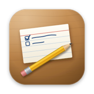
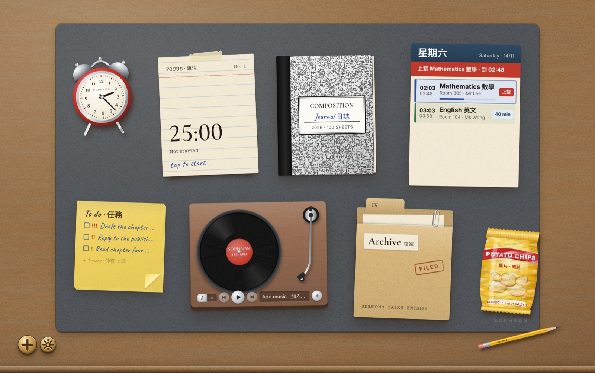
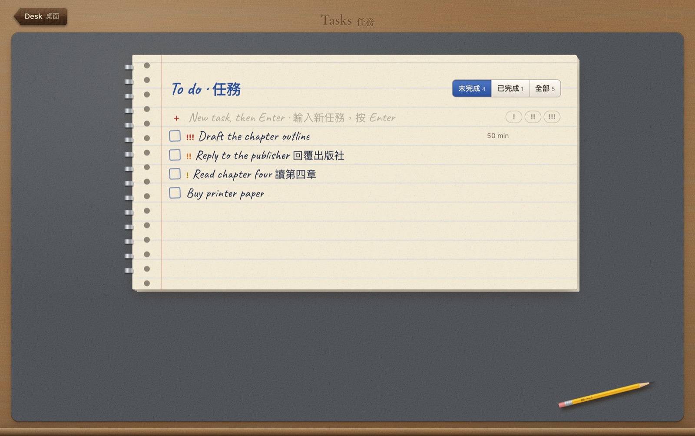
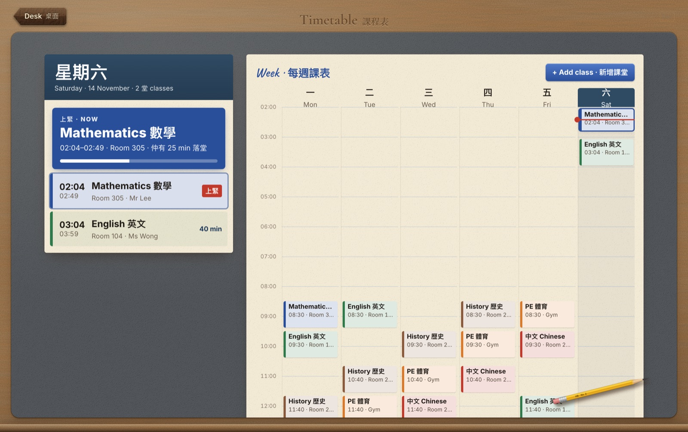
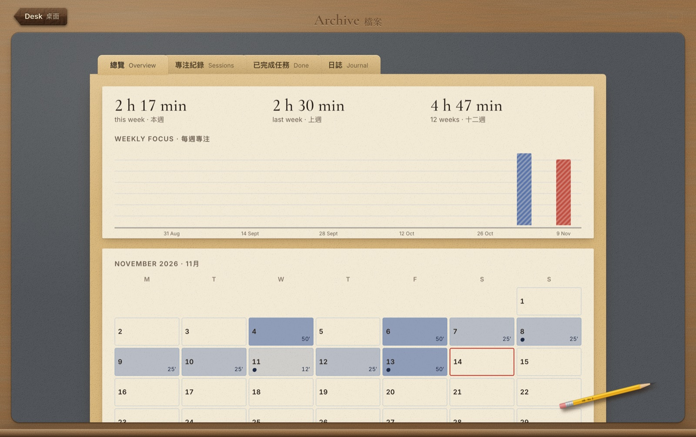
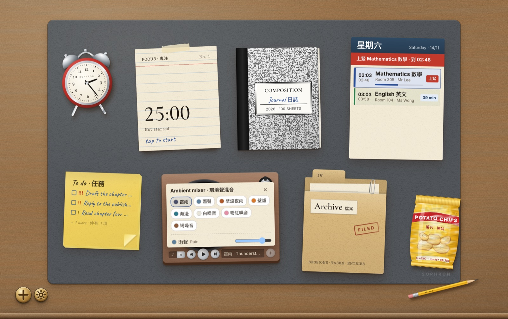
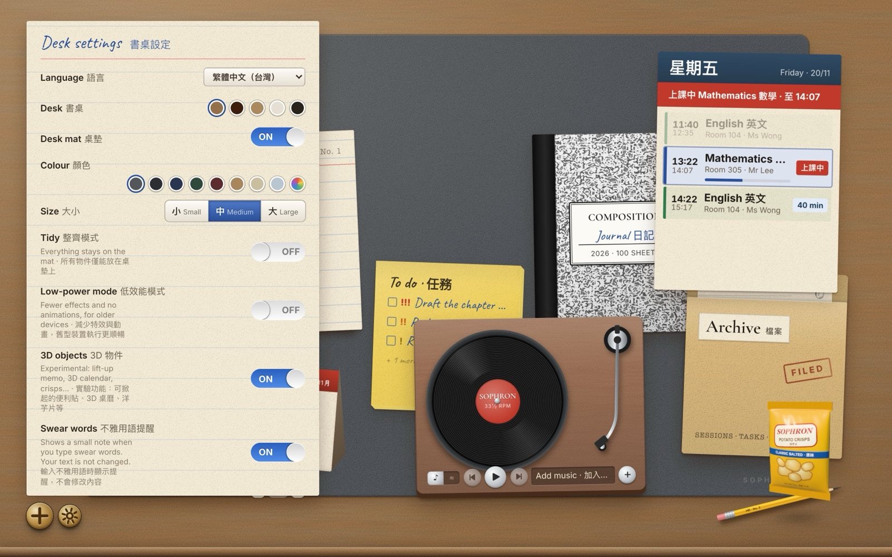
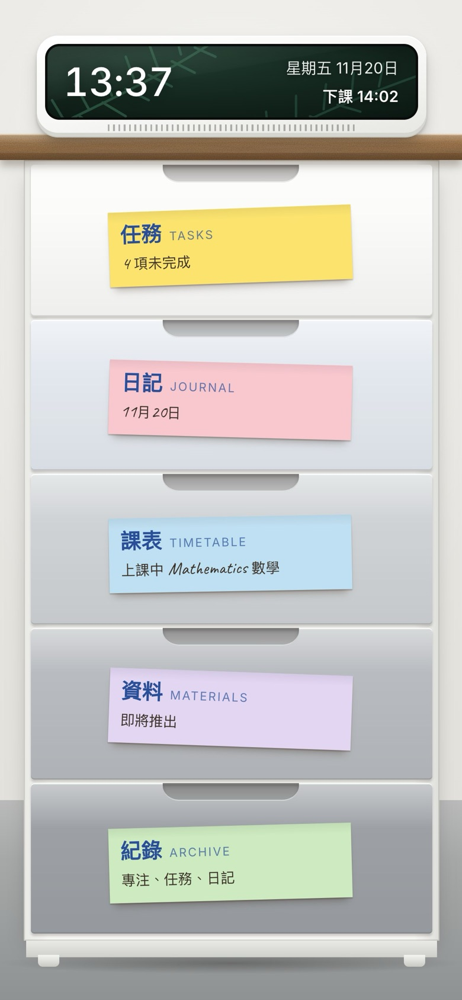
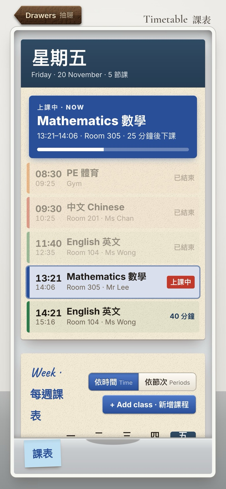

<p align="center">
  
</p>

<h1 align="center">SOPHRON</h1>

<p align="center">
  一張屬於您的私人書桌：電腦、平板、手機都能用
</p>

<p align="center">
  <a href="https://github.com/HelloWorld233a/SOPHRON/releases"></a>
  
  
  
  
  
  
</p>

<p align="center">
  <b>繁體中文</b> · <a href="README.md">English</a>
</p>

<p align="center">
  
</p>

<p align="center">
  <a href="https://helloworld233a.github.io/SOPHRON/"><b>▶ 線上試用</b></a> — 直接在瀏覽器中試用，內含示範任務、課表與日記（不會儲存任何資料）。
  <br>
  <a href="https://github.com/HelloWorld233a/SOPHRON/releases/latest"><b>⬇ 下載</b></a> macOS、Windows 與 Android 版本。
</p>

---

## 目錄

1. [SOPHRON 是什麼](#1-sophron-是什麼)
2. [截圖](#2-截圖)
3. [主要功能](#3-主要功能)
4. [手機版：抽屜櫃](#4-手機版抽屜櫃)
5. [語言](#5-語言)
6. [自訂您的書桌](#6-自訂您的書桌)
7. [安裝](#7-安裝)
8. [您的資料](#8-您的資料)
9. [開發狀態](#9-開發狀態)
10. [技術架構](#10-技術架構)
11. [未來計畫](#11-未來計畫)
12. [意見回饋、授權與致謝](#12-意見回饋授權與致謝)

## 1. SOPHRON 是什麼

SOPHRON 是一款以「私人書桌」為概念的生產力應用程式。主畫面是一張書桌，桌上每件物件開啟一項功能：索引卡是專注計時、便利貼是任務、作文簿是日記、資料夾是檔案、課表卡是每週課程，唱盤則用來播放音樂。您可以依自己的習慣移動、縮放、新增或移除這些物件。

在手機上，同一個應用程式會變成擺在書桌旁的**抽屜櫃**：每個抽屜對應一項功能，櫃頂放著一座時鐘。

SOPHRON 採用**本機優先**（local-first）設計：所有資料只儲存在您的裝置上，不需要帳號，不使用雲端，也不會透過網際網路傳送任何資料。

> 本儲存庫僅發布安裝檔，原始碼目前未公開。

**免安裝試用：** [線上示範版](https://helloworld233a.github.io/SOPHRON/)在瀏覽器中執行，就像店內的展示機，已預先放入示範任務、課表、日記與專注紀錄，3D 物件也已開啟。每次開啟都會重新開始，不會儲存任何資料。用手機開啟，即可看到抽屜櫃版面。

## 2. 截圖

以下截圖皆為示範資料。

| 書桌 | 初次設定 |
| :---: | :---: |
|  |  |
| **任務** | **課表** |
|  |  |
| **檔案** | **唱盤與環境音** |
|  |  |
| **書桌設定（含語言）** | **手機版** |
|  |   |

## 3. 主要功能

| 功能 | 說明 |
| --- | --- |
| **專注計時** | 番茄鐘式的專注、短休息與長休息；可自訂長度與自動開始；可連結正在進行的任務；顯示今日與最近七日統計；每段結束時發出系統通知。切換頁面或電腦進入睡眠時，計時依然準確。 |
| **任務** | 新增、勾選完成與排序；三級優先順序；備註；依未完成、已完成或全部篩選；可直接從任務開始專注。 |
| **日記** | 每日一頁，支援粗體、斜體、標題、清單與引言；輸入時自動儲存；可跳至任何日期；顯示字數。 |
| **檔案** | 十二週專注圖表、顯示每日專注分鐘與日記的月曆、專注紀錄、已完成任務及所有日記頁面。 |
| **課表** | 每週課程，可設定科目、時間、教室、老師、顏色與備註；顯示目前與下一堂課。可設定每日節次（含下課與午休），依時間或依節次檢視整週；一次將課程加到多天，或將同一科目批次放入多個節次；課程重疊時提示；更改上下課時間時，課程會一併移動。 |
| **唱盤** | 播放您自己的音樂檔案：播放清單、重複、隨機、音量及可拖曳的進度列。也可切換為環境音模式，自由混合雨聲、雷聲、風聲、海浪、壁爐，以及白噪音、粉紅噪音與棕噪音，並提供八組預設。 |
| **便利貼及其他** | 便利貼（其中一款可以掀起，下方藏有秘密空間，可設定密碼）、鬧鐘、桌曆與一包洋芋片。 |
| **資料安全** | 本機 SQLite 資料庫；每日自動備份（保留最近十份）；手動備份與 JSON 匯出；刪除後可復原。 |
| **不雅用語提醒** | 輸入粵語、英語或華語的不雅用語時顯示小提醒。不會修改您的文字，也可以關閉。 |
| **畫面不再整片空白** | 若某件物件無法顯示，只會在原位顯示一張小卡片，其他功能照常運作；損壞的設定會自動恢復為預設值。 |

## 4. 手機版：抽屜櫃


設計概念：**電腦是書桌，手機是書桌旁的抽屜櫃。** 在手機上（Android，直向），SOPHRON 不會把整張書桌硬塞進小螢幕，而是顯示一座白色五層抽屜櫃：

- **抽屜：** 任務、日記、課表、資料與檔案。每個抽屜貼著一張便利貼，寫著裡面的內容：未完成任務數量、今天的日期、目前或下一堂課。
- **木製櫃頂** 橫跨整個螢幕，使用與電腦書桌相同的木紋。在電腦上更換木紋，手機也會跟著改變，兩者就像同一套家具。
- **櫃頂時鐘** 顯示時間、日期與下一堂課（或本堂何時下課），專注時則顯示剩餘時間。點選時鐘可開啟「專注」與「設定」。
- **拉開抽屜** 即進入該功能，畫面顏色與抽屜內部一致；點選左上角「抽屜」返回。
- 每個功能都有專為手機設計的版面，任務、日記、檔案與課表在寬度 320 px 的螢幕上也能完整顯示。
- 平板維持橫向的完整書桌。長按物件（手指下方會出現逐漸填滿的圓圈）才能移動，滑動時不會誤拖物件。

**手機 ⇄ 電腦同步（實驗功能，預設關閉）。** 手機可在同一 Wi-Fi 下與電腦配對，同步任務、課表、日記與專注紀錄，不需要帳號，也不經過伺服器。配對使用的 6 位數代碼不會在網路上傳送，每次同步皆經過加密。測試期間此功能預設關閉並隱藏：請至**開發人員選項 → 手機連線**開啟（在書桌設定中連續點選版本號碼七次即可解鎖開發人員選項）。關閉時，不會在網路上等待任何連線。

<br clear="right">

## 5. 語言

**書桌設定 → 語言** 提供三種選擇，每台裝置各自保存。

| 選項 | 顯示方式 |
| --- | --- |
| **繁體中文（台灣）** | 英文與繁體中文並列，使用台灣正式書面用語（書桌、桌墊、課表、日記、洋芋片……）。 |
| **简体中文（新加坡）** | 英文與簡體中文並列，採用新加坡用語（设置、文件夹、时间表、薯片……），部分句子帶有新加坡語氣，例如完成設定時會顯示「搞定了！」。 |
| **English** | 只顯示英文。 |

日期、時間與計時通知都會依語言顯示。語言只影響介面文字，您輸入的任務、日記與課程名稱不會被轉換。

## 6. 自訂您的書桌

- **拖曳** 物件即可移動，拖曳右下角可調整大小（觸控螢幕需先長按）。任何物件都可以置頂。
- 從左下角「＋」抽屜**新增或移除**物件。便利貼、鬧鐘與洋芋片可以放置多個。
- **個別物件顏色：** 鬧鐘外殼、任務便利貼紙色、課表卡頂部與唱盤底座。
- **書桌設定（⚙）：** 五種木紋；八種桌墊顏色或自訂顏色；三種桌墊大小；「整齊模式」讓所有物件只能放在桌墊上；視窗置頂；Windows 可切換全螢幕（`F11`）。
- **3D 物件（實驗功能，電腦上預設開啟）：** 精裝日記本、專注方塊、三角桌曆、洋芋片與可掀起的便利貼。開啟或關閉 3D 都不會影響您的資料。
- **低效能模式：** 減少特效並取消頁面動畫，適合較舊的裝置。Android 10 以前的版本及較舊或入門級處理器會自動開啟（[處理器清單](docs/LOW_POWER_CHIPS.md)），開啟時會暫停 3D。
- **初次設定** 引導您選擇書桌樣式、桌上物件與專注長度，之後可在書桌設定中重新進行。

桌上每件物件都是內建的**書桌外掛**，共九個，於編譯時登錄。每件物件的位置、大小、前後順序與設定都儲存在本機資料庫中。目前尚不支援第三方外掛。

## 7. 安裝

請至 [Releases](https://github.com/HelloWorld233a/SOPHRON/releases) 下載最新版本：

| 系統 | 檔案 |
| --- | --- |
| macOS（Apple Silicon） | `SOPHRON_…_macOS_AppleSilicon.dmg` |
| Windows 10 / 11（64 位元） | `SOPHRON_…_Windows_x64-setup.exe` |
| Android 手機與平板（arm64，Android 7.0 以上） | `SOPHRON_…_Android_arm64.apk` |

**macOS**

1. 開啟 `.dmg`，將 SOPHRON 拖曳至「應用程式」資料夾。
2. SOPHRON 尚未取得 Apple 開發者簽署，因此 macOS 會提示無法驗證開發者。第一次開啟時，請在「應用程式」中按右鍵點選 SOPHRON，再選擇**打開**。macOS 15 以上請先開啟一次，然後前往**系統設定 → 隱私權與安全性**，點選**強制打開**。之後即可正常開啟。
3. 若 macOS 顯示 SOPHRON **「已損毀」**，代表您下載的是 2026 年 11 月 20 日 13:40（UTC+8）之前的 beta 4：請刪除後重新下載。

**Windows**

1. 執行 `setup.exe`。
2. 若出現「Windows 已保護您的電腦」，請點選**其他資訊**，再點選**仍要執行**。
3. 安裝程式需要 Microsoft WebView2，若電腦上沒有會自動下載。

**Android**

1. 在手機或平板上下載 `.apk`（或將檔案複製到裝置中）。
2. 開啟檔案，並允許從該來源（您使用的瀏覽器或檔案管理員）安裝應用程式。
3. 更新時，直接將新版 `.apk` 安裝在舊版上即可。每個版本都使用同一把金鑰簽署，資料會保留。
4. **解除安裝會一併刪除資料**，包括備份（備份也存放在應用程式內）。Android 版目前尚無匯出功能。
5. 加入的音樂檔案在關閉應用程式前都可播放，但不會保留在播放清單中。環境音不受影響。

**基本操作**

- 點選物件即可開啟；點選左上角**書桌**（或按 `Esc`）返回。在手機上點選抽屜開啟，點選**抽屜**返回。
- `⌘`（Windows 為 `Ctrl`）+ `1` 至 `6`：書桌、專注、任務、日記、檔案、課表。

**驗證下載檔案。** 每個版本都附有 `SHA256SUMS.txt`：

```bash
# macOS
shasum -a 256 SOPHRON_*.dmg
```

```powershell
# Windows
certutil -hashfile SOPHRON_0.1.0-beta.4_Windows_x64-setup.exe SHA256
```

## 8. 您的資料

所有資料都只存在您的裝置上：沒有帳號、沒有使用分析，也不會連上網路。

| 系統 | 位置 |
| --- | --- |
| macOS | `~/Library/Application Support/app.sophron.desktop/` |
| Windows | `%APPDATA%\app.sophron.desktop\` |
| Android | 應用程式自身的儲存空間（解除安裝時會一併刪除） |

資料庫檔案為 `sophron.db`，自動備份存放在同一位置的 `backups` 資料夾中。每次升級變更資料庫前，也會先自動備份。

## 9. 開發狀態

**版本：0.1.0-beta.4（測試版）**

| 項目 | 狀態 |
| --- | --- |
| macOS（Apple Silicon） | 已提供安裝檔。 |
| macOS（Intel） | 尚未提供。 |
| Windows 10 / 11（64 位元） | 已提供安裝檔。 |
| Android 平板 | 自 beta 3 起提供 APK（橫向，完整書桌）。 |
| Android 手機 | **beta 4 新增：** 抽屜櫃版面（直向）。已在電腦上編譯與檢查，**歡迎回報在您手機上的使用情況。** |
| 手機 ⇄ 電腦同步 | 實驗功能，預設關閉（開發人員選項 → 手機連線）。 |
| 程式碼簽署 | 尚未取得 Apple 或 Microsoft 開發者簽署（請見「安裝」）。 |

此為測試版，可能仍有錯誤。建議不時使用書桌設定中的**備份**功能。

### 0.1.0-beta.4 更新重點

- **手機版：** 附時鐘與木製櫃頂的抽屜櫃，每個功能都有手機專用版面。
- **三種語言：** 繁體中文（台灣）、简体中文（新加坡）或 English。
- **中文介面** 全面改寫為台灣正式書面用語。
- **畫面不再整片空白：** 單一物件出錯不會再拖垮整張書桌。
- **手機 ⇄ 電腦同步：** 已完成並加密，測試期間放在開發人員選項中。
- **macOS：** 應用程式現已完整簽署（ad hoc），下載後不會再顯示「已損毀」。
- 修正多項錯誤。

<details>
<summary>舊版本</summary>

**0.1.0-beta.3**

- Android 平板：提供 APK（橫向、全螢幕）；長按物件即可移動。
- 3D 物件向所有人開放（實驗功能，電腦上預設開啟）。
- 低效能模式，較舊裝置會自動開啟。
- 線上示範版。
- 觸控螢幕上可捲動較長的便利貼內容；修正多項錯誤。

**0.1.0-beta.2**

- 唱盤面板：播放清單、重複、隨機、音量、進度與顏色。
- 課表：節次、一次加入多天、批次加入、重疊提示、課程隨上下課時間移動。
- Windows：全螢幕（`F11`）並改用微軟正黑體顯示中文。
- 頁面切換更流暢；不會再誤選畫面上的文字。

</details>

## 10. 技術架構

| 層級 | 技術 |
| --- | --- |
| 應用程式框架 | [Tauri 2](https://tauri.app/)：同一套程式支援 macOS、Windows 與 Android，以系統內建的網頁引擎繪製介面 |
| 介面 | React 19、TypeScript、Vite |
| 後端 | Rust（2024 edition） |
| 資料庫 | SQLite，透過 rusqlite（WAL 模式、版本化遷移） |
| 文字編輯器 | TipTap |
| 音效 | Web Audio API（環境音即時合成，不使用錄音檔） |
| 手機連線 | UDP 探索、SPAKE2 配對、ChaCha20-Poly1305 加密（實驗功能） |

- **計時器** 在 Rust 端以實際時間戳記運作，切換頁面或睡眠後依然準確。
- **資料庫遷移前先備份**，升級時不會遺失資料。
- **擬物化設計：** 所有元素都模仿真實物件，紋理與圖示皆為原創繪製。
- **一套文字，三種語言：** 簡體中文由台灣繁體文字轉換而來，再替換為新加坡用語與句子。

## 11. 未來計畫

以下項目已在規劃中，尚無確定日期：

- 手機 ⇄ 電腦同步正式開放，並支援以 QR Code 配對。
- 資料抽屜：將相片與筆記從手機傳送到電腦上的資料夾。
- macOS 與 Windows 程式碼簽署。
- 完成 3D 物件並移除「實驗功能」標示。
- Android 匯出與匯入功能；在更多手機與平板上測試。
- 確認各系統的最低版本需求。

## 12. 意見回饋、授權與致謝

**意見回饋。** 由於原始碼尚未公開，目前無法接受程式碼貢獻。歡迎在 [Issues](https://github.com/HelloWorld233a/SOPHRON/issues) 回報錯誤或提出建議，請附上您的系統與版本、SOPHRON 版本，以及重現問題的步驟。

**授權。** 目前尚未指定授權條款。

**致謝。** SOPHRON 使用以下開源專案製作：[Tauri](https://tauri.app/)、[React](https://react.dev/)、[Vite](https://vite.dev/)、[TipTap](https://tiptap.dev/)、[rusqlite](https://github.com/rusqlite/rusqlite) 與 [SQLite](https://sqlite.org/)。介面字型 Inter、Caveat 與 Cormorant Garamond 採用 SIL Open Font License，經由 [Fontsource](https://fontsource.org/) 提供。
