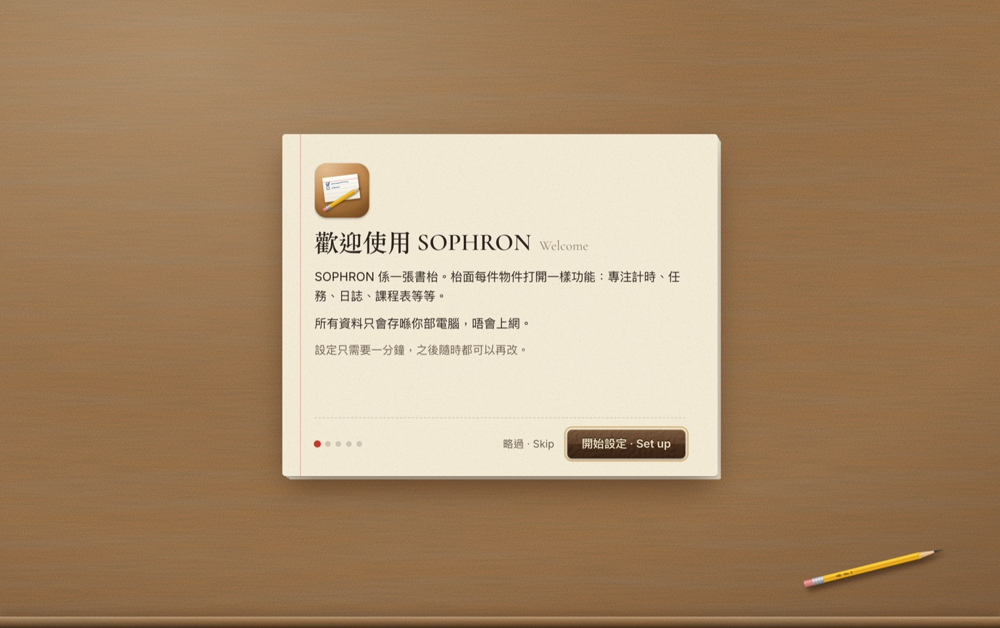

<p align="center">
  
</p>

<h1 align="center">SOPHRON</h1>

<p align="center">
  一張屬於你的數碼書桌
</p>

<p align="center">
  <a href="https://github.com/HelloWorld233a/SOPHRON/releases"></a>
  
  
  
  
  
</p>

<p align="center">
  <b>繁體中文</b> · <a href="README.md">English</a>
</p>

<p align="center">
  
</p>

<p align="center">
  <a href="https://helloworld233a.github.io/SOPHRON/"><b>▶ 網上試玩</b></a> — 直接喺瀏覽器試，有示範任務、課程表同日誌（唔會儲存任何資料）。
</p>

---

## 1. SOPHRON

**一張屬於你的數碼書桌。**

## 2. 專案簡介

SOPHRON 是一款以私人數碼書桌為概念的生產力應用程式。主畫面是一張書桌，桌上每件物件對應一項功能：索引卡是專注計時、便利貼是任務、作文簿是日誌、文件夾是紀錄、課程表卡是每週課表。使用者可以按自己的習慣擺放、縮放及增減這些物件。

SOPHRON 是本地優先（local-first，即資料儲存在自己的電腦，而不是雲端）的桌面應用程式。所有資料只會儲存在使用者的電腦，不需要帳戶，亦不會上傳到網絡。

> 本 repository 只發佈安裝檔，原始碼目前沒有公開。

**免安裝試玩：** [網上示範版](https://helloworld233a.github.io/SOPHRON/)喺瀏覽器入面行，好似商店嘅示範機一樣：已經有示範任務、課程表、日誌同專注紀錄，3D 物件亦已開啟。每次打開都係全新開始，唔會儲存任何資料。示範版只係試食；正式版會將資料存喺你部電腦、自動備份，同埋播放你自己嘅音樂。

## 3. 截圖及預覽

以下截圖來自目前版本，畫面內容均為示範資料。

| 書桌主畫面 | 首次使用設定 |
| :---: | :---: |
|  |  |
| **任務** | **課程表** |
|  |  |
| **紀錄** | **唱片機及環境聲混音** |
|  |  |

## 4. 主要功能

| 功能 | 說明 |
| --- | --- |
| 專注計時 | 番茄鐘式計時，包括專注、短休息、長休息；可設定長度及自動開始；可連結正在處理的任務；顯示今日及最近七日的統計；計時結束時會發出系統通知。 |
| 任務 | 新增、完成、排序任務；三級優先次序；備註；按「未完成／已完成／全部」篩選；可直接開始專注處理某項任務。 |
| 日誌 | 每日一頁，支援粗體、斜體、標題、列點、編號及引言；自動儲存；可切換日期；顯示字數。 |
| 紀錄 | 每週專注時間圖表（十二週）、月曆（顯示每日專注分鐘及日誌紀錄）、專注紀錄、已完成任務及日誌列表。 |
| 課程表 | 每週課表，可設定科目、時間、地點、老師、顏色及備註；顯示今日「正在上課」及「下一堂」。可設定每日節數，按時間或按節數顯示整週；一次過把同一堂加到幾日，或把同一科目批量放進多個節數；課堂重疊時會提示；更改上課時間時，課堂會跟隨移動。 |
| 唱片機 | 播放電腦內自行選擇的音樂檔案。點擊唱片打開面板：播放清單（播放、排序、移除）、全部循環或單曲循環、隨機播放、音量、可拖動的進度條及唱片顏色。亦可切換為環境聲模式，自由疊加雨聲、雷聲、風聲、海浪、壁爐、白噪音、粉紅噪音及褐噪音，並提供八個預設組合。 |
| 資料安全 | 使用本地 SQLite 資料庫；每日自動備份（保留最近十份）；可手動備份及匯出 JSON；刪除項目時提供復原。 |
| 粗口提示 | 輸入粵語、英文或普通話粗口時顯示提示，不會改動文字內容，可以關閉。 |

## 5. 桌面自訂及插件系統

### 桌面自訂

- 拖動物件改變位置，拉動右下角改變大小。
- 每件物件可以「置頂」，保持在其他物件上方。
- 部分物件可以個別更改顏色：鬧鐘外殼、任務便利貼紙色、課程表卡頂部顏色、唱片機底座。
- 書桌設定：五種桌面木色；八種枱墊顏色及自訂顏色；三種枱墊大小；「整齊模式」限制物件只放在枱墊上；視窗置頂。
- 首次使用設定：第一次開啟時引導選擇桌面風格、桌上物件及專注時間長度，之後可以在書桌設定中重新進行。

### 插件系統（目前實現程度）

桌上每件物件都是一個「桌面插件」（desk plugin）。目前的插件系統：

| 項目 | 現況 |
| --- | --- |
| 插件來源 | 內置於應用程式，在編譯時自動登記。目前不支援在執行期間載入第三方插件。 |
| 內置插件 | 鬧鐘、專注、任務、日誌、紀錄、課程表、唱片機、便條、薯片，共九個。 |
| 使用者可進行的操作 | 從左下角「＋」抽屜新增或移除；拖動；縮放（保持比例）；置頂；個別自訂顏色。便條、鬧鐘及薯片可以擺放多於一件。 |
| 儲存 | 每件物件的位置、大小、層次及設定會儲存在本地資料庫，重新開啟時還原。 |
| 3D 插件 | **實驗功能，已向所有人開放。** 在書桌設定有開關（電腦上預設開啟）。包括精裝日誌書、專注方塊、座枱日曆、一包薯片，以及可以揭起的便條（下面有隱藏空間，可設定密碼）。開啟或關閉 3D 都不會改動你的資料。低效能模式開啟時會暫停使用 3D。 |

## 6. 技術架構及使用技術

| 層級 | 技術 |
| --- | --- |
| 桌面框架 | [Tauri 2](https://tauri.app/)（以系統內置網頁引擎顯示介面的輕量桌面框架） |
| 介面 | React 19、TypeScript、Vite |
| 後端 | Rust（2024 edition） |
| 資料庫 | SQLite（經 rusqlite，使用 WAL 模式及版本化資料庫遷移） |
| 文字編輯 | TipTap |
| 音效 | Web Audio API（環境聲以程式即時合成，不使用錄音檔） |

架構重點：

- **計時器** 由 Rust 端以實際時間戳記運行，即使切換房間或電腦休眠，時間仍然準確。
- **資料庫遷移前自動備份**，避免升級時遺失資料。
- **介面** 採用擬物化（skeuomorphism，模仿真實物件質感）設計，所有紋理及圖示均為原創繪製。

## 7. 目前開發狀態

**版本：0.1.0-beta.4（測試版）**

| 項目 | 狀態 |
| --- | --- |
| macOS（Apple Silicon） | 已提供安裝檔；功能已在開發者的電腦上以開發版本測試。 |
| macOS（Intel） | 尚未提供。 |
| Windows 10 / 11（64 位元） | 已提供安裝檔。beta 1 的中文字體問題已在 beta 2 修正（如仍有問題，歡迎在 Issues 回報）。 |
| Android 手機與平板（arm64，Android 7.0 或以上） | 提供可安裝的 APK（平板自 beta 3 起；beta 4 起手機有專屬的抽屜櫃版面）。已在電腦上編譯與檢查；**歡迎回報在您裝置上的表現。** |
| 程式碼簽署 | 尚未簽署（安裝時會出現系統安全提示，見下文）。 |
| 最低系統版本 | 待確認。 |

這是測試版本，可能仍有錯誤。建議定期使用書桌設定中的「備份」功能。

### 0.1.0-beta.4 更新重點

- **三種語言：** 書桌設定 → 語言，可選擇繁體中文（台灣）、简体中文（新加坡用語）或 English。只變更介面文字，您輸入的內容不受影響。
- **中文介面改用台灣書面語：** 所有中文文字改為正式書面語，用詞更精簡。
- **手機版抽屜櫃：** 在手機上，書桌會變成五格抽屜櫃，頂部有木板與時鐘，每個抽屜開啟一項功能。
- **視窗不再整片空白：** 若某個物件無法顯示，只會在原位顯示一張小卡片，其他功能照常使用；損壞的設定會自動恢復為預設值。
- **手機 ⇄ 電腦同步（實驗功能，預設關閉）：** 在同一 Wi-Fi 下直接配對同步，無需帳號或伺服器。目前位於開發人員選項 → 手機連線；關閉時不會顯示，也不會在網路上等待連線。
- 修正多項錯誤。

### 0.1.0-beta.3 更新重點

- **Android 平板：** SOPHRON 而家有 APK 俾 Android 平板安裝（橫向、全螢幕）。喺觸控螢幕上，撳住物件（手指位會有個圓圈慢慢填滿）先會拎起移動，所以掃一下唔會誤拖動物件。
- **3D 向所有人開放：** 書桌設定有「實驗功能」開關，電腦上預設開啟。低效能模式開啟時會暫停使用。
- **低效能模式：** 書桌設定同首次設定都有開關。減少特效同取消開關房間動畫，適合舊機。Android 低過 10，或者較舊／入門級處理器會自動開啟（[清單公開](docs/LOW_POWER_CHIPS.md)）。
- **網上示範版：** 直接喺瀏覽器試玩，有示範任務、課程表同日誌。
- **便條：** 觸控螢幕上長文字可以捲動。
- 修正多項錯誤。

### 0.1.0-beta.2 更新重點

- **唱片機：** 點擊唱片打開面板，包括播放清單、循環、隨機播放、音量、進度及外觀。
- **課程表：** 節數、一次過加到幾日、批量新增、重疊提示，以及課堂跟隨上課時間移動。
- **Windows：** 全螢幕（F11，或書桌設定中的開關）；中文改用微軟正黑體，不再幼細及有鋸齒。
- **更順暢：** 開關房間的動畫更順暢；畫面上的文字不會再被誤選（只有輸入文字的地方可以選取）。
- **3D：** 已預備好，但仍在實驗階段，預設關閉（見上方插件表）。
- 修正多項錯誤。

## 8. 安裝及使用方法

前往 [Releases](https://github.com/HelloWorld233a/SOPHRON/releases) 下載最新版本：

| 系統 | 檔案 |
| --- | --- |
| macOS（Apple Silicon） | `SOPHRON_…_macOS_AppleSilicon.dmg` |
| Windows 10 / 11（64 位元） | `SOPHRON_…_Windows_x64-setup.exe` |
| Android 平板（arm64） | `SOPHRON_…_Android_arm64.apk` |

**macOS**

1. 開啟 `.dmg`，把 SOPHRON 拖到「應用程式」。
2. 由於應用程式尚未經 Apple 簽署，第一次開啟時請在「應用程式」中按右鍵點選 SOPHRON，選擇「打開」，再按「打開」。之後可以正常開啟。

**Windows**

1. 執行 `setup.exe`。
2. 如果出現「Windows 已保護您的電腦」，按「其他資訊」→「仍要執行」。
3. 安裝程式需要 Microsoft WebView2；如電腦尚未安裝，安裝程式會自動下載。

**Android**

1. 喺平板下載 `.apk`（或者由電腦傳過去）。
2. 開啟檔案。Android 會問你准唔准用呢個來源安裝程式：請俾你用嘅瀏覽器或者檔案管理員通過。
3. 安裝並開啟 SOPHRON。更新時直接用新版 `.apk` 覆蓋安裝（每個版本都用同一條鎖匙簽名，資料會保留）。
4. 你嘅資料存喺 app 自己嘅儲存空間，**解除安裝 app 會一併刪除資料**。請使用書桌設定嘅「備份」；備份都喺 app 入面，所以解除安裝後亦會冇咗。Android 版暫時冇匯出同「打開備份資料夾」。
5. 加入嘅音樂檔只可以播到閂 app 為止，唔會留喺播放清單；環境聲唔受影響。

**基本操作**

- 點擊桌上的物件開啟對應功能；按左上角「桌面」或 `Esc` 返回書桌。
- Windows：按 `F11` 開啟或關閉全螢幕。
- `⌘`（Windows 為 `Ctrl`）+ `1` 至 `6`：書桌、專注、任務、日誌、紀錄、課程表。

**資料位置**

| 系統 | 位置 |
| --- | --- |
| macOS | `~/Library/Application Support/app.sophron.desktop/` |
| Windows | `%APPDATA%\app.sophron.desktop\` |

資料庫為 `sophron.db`，自動備份位於同一資料夾內的 `backups`。

**檢查檔案**

每個 Release 均附有 `SHA256SUMS.txt`：

```bash
# macOS
shasum -a 256 SOPHRON_*.dmg
```

```powershell
# Windows
certutil -hashfile SOPHRON_0.1.0-beta.4_Windows_x64-setup.exe SHA256
```

## 9. 未來開發計劃

以下項目仍在計劃階段，未有完成時間：

- macOS 及 Windows 程式碼簽署。
- 完成及測試 3D 插件，然後取消「實驗功能」標籤。
- 喺更多 Android 平板上測試，並為 Android 加入匯出同匯入。
- 確認並記錄最低系統版本。

## 10. 參與專案

原始碼目前沒有公開，因此暫時未能接受程式碼貢獻。歡迎透過 [Issues](https://github.com/HelloWorld233a/SOPHRON/issues) 回報問題或提出建議。回報問題時，請附上作業系統版本、SOPHRON 版本及重現步驟。

## 11. 授權

目前尚未指定授權。

## 12. 致謝

SOPHRON 使用以下開源專案：[Tauri](https://tauri.app/)、[React](https://react.dev/)、[Vite](https://vite.dev/)、[TipTap](https://tiptap.dev/)、[rusqlite](https://github.com/rusqlite/rusqlite) 及 [SQLite](https://sqlite.org/)。介面字型 Inter、Caveat 及 Cormorant Garamond 以 SIL Open Font License 授權，經 [Fontsource](https://fontsource.org/) 提供。
